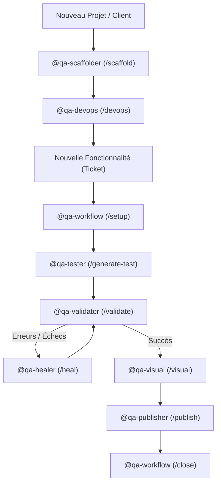

# 🧭 QA-Hub Master Workflow

Ce document définit l'orchestration des agents spécialisés pour garantir un cycle de vie de développement des tests fluide, robuste, documenté et tracé.

---

## 🔄 Le Cycle de Vie Global

---

## 📋 Les Phases d'Ingénierie

### 0️⃣ INITIALISATION PROJET (Onboarding)
* **Agent :** `@qa-scaffolder`
* **Commandes :** `/scaffold <id>`, `/new-client`
* **Action :** Lit `projects/<id>.json`, génère l'arborescence Playwright, le PageObject initial, le test smoke, la documentation et enregistre le client dans `qa-dashboard`.

### 1️⃣ INFRASTRUCTURE & CI/CD
* **Agent :** `@qa-devops`
* **Commandes :** `/devops`, `/setup-ci <provider>`
* **Action :** Configure les pipelines (GitHub Actions, GitLab CI, Azure DevOps), le sharding et le cache des navigateurs.

### 2️⃣ ORCHESTRATION DU TICKET
* **Agent :** `@qa-workflow`
* **Commandes :** `/setup`, `/workflow`
* **Action :** Lit le ticket Jira/Linear, vérifie ou crée la branche Git selon le pattern du projet (`branchPattern`), valide le contexte.

### 3️⃣ DÉVELOPPEMENT DES TESTS
* **Agent :** `@qa-tester`
* **Commandes :** `/test`, `/generate-test`
* **Skill associé :** `PlaywrightArchitect`
* **Action :** Génère les Page Objects héritant de `BasePage` et les scénarios de test dans `packages/playwright-tests/tests/<project>/`.

### 4️⃣ GATEKEEPER TECHNIQUE
* **Agent :** `@qa-validator`
* **Commandes :** `/validate`
* **Action :** Lance le typechecking, le linter et vérifie l'absence d'anti-patterns (`test.only`, `console.log`, secrets visibles).

### 5️⃣ AUTO-RÉPARATION (YOLO Mode)
* **Agent :** `@qa-healer`
* **Commandes :** `/heal`, `/autofix`
* **Action :** Répare de manière autonome les erreurs TypeScript, les règles ESLint violées et réajuste les sélecteurs DOM en cas de timeout.

### 6️⃣ CONTRÔLE VISUEL A/B
* **Agent :** `@qa-visual`
* **Commandes :** `/visual`, `/update-baselines`
* **Action :** Compare les captures d'écran Desktop/Mobile avec masquage des éléments dynamiques et gestion de la tolérance pixel.

### 7️⃣ PUBLICATION & LIVRAISON
* **Agent :** `@qa-publisher`
* **Commandes :** `/publish`, `/commit`
* **Action :** Prépare un commit conventionnel atomique validé par le projet, pousse la branche et prépare la PR / Merge Request.

### 8️⃣ CLÔTURE DU CYCLE
* **Agent :** `@qa-workflow`
* **Commandes :** `/close`
* **Action :** Met à jour le statut du ticket, synchronise les rapports avec `qa-dashboard` et nettoie l'espace de travail.
