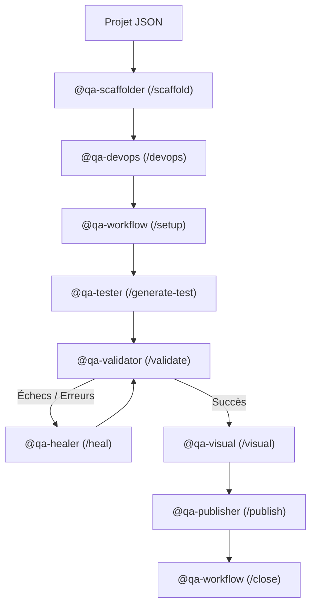

# 11 - Master Workflow d'Orchestration des Agents IA

**QA-Hub** intègre une suite d'agents d'ingénierie logicielle autonomes et semi-autonomes, conçus pour piloter l'intégralité du cycle de vie des tests sans friction.

---

## 🔄 Le Cycle d'Ingénierie Complet

---

## 🤖 Répertoire des Agents Spécialisés

### 1. 🏗️ `@qa-scaffolder` (Onboarding de Projet)
- **Déclencheur :** `/scaffold`, `@qa-scaffolder`
- **Mission :** Prend en entrée un fichier `projects/<id>.json` (ou interroge interactivement l'utilisateur) et instancie immédiatement :
  - L'arborescence Playwright (`tests/<id>/`, `pages/<id>/`, `fixtures/<id>/`).
  - La classe `BasePage` typée avec les URLs cibles.
  - Le premier test témoin (`smoke.spec.ts`).
  - L'enregistrement dans `playwright.config.ts`.
  - La mise à jour des scopes Husky/Commitlint.
  - L'enregistrement dans `qa-dashboard`.

### 2. 🚀 `@qa-devops` (CI/CD Multi-Plateforme)
- **Déclencheur :** `/devops`, `@qa-devops`
- **Mission :** Configure ou met à jour la chaîne CI/CD selon le provider du projet :
  - Génération de `.github/workflows/e2e.yml` (GitHub Actions).
  - Génération de `.gitlab-ci.yml` (GitLab CI).
  - Génération de `azure-pipelines.yml` (Azure DevOps).
  - Gestion du parallélisme, du sharding et du cache des navigateurs.

### 3. 🧭 `@qa-workflow` (Orchestration & Cycle Jira)
- **Déclencheur :** `/setup`, `/close`, `@qa-workflow`
- **Mission :** Analyse le besoin métier à partir du ticket Jira/Linear, valide le nommage de la branche Git selon la convention du projet et coordonne les étapes.

### 4. 🎭 `@qa-tester` (Génération & Automatisation Playwright)
- **Déclencheur :** `/test`, `/generate-test`
- **Mission :** Implémente le pattern Page Object Model (POM) et les specs Playwright à partir d'une user story ou d'une page web cible, en garantissant des sélecteurs robustes.

### 5. 🛡️ `@qa-validator` (Gatekeeper Technique)
- **Déclencheur :** `/validate`, `@qa-validator`
- **Mission :** Exécute l'audit qualité pré-commit :
  - Linting et Typechecking strict (`pnpm typecheck`, `pnpm lint`).
  - Détection de patterns interdits (`console.log`, `test.only`, mots de passe ou tokens hardcodés).

### 6. 🩺 `@qa-healer` (Auto-Réparation Proactive)
- **Déclencheur :** `/heal`, `@qa-healer`
- **Mission :** Résout de façon autonome (mode YOLO) les erreurs de compilation TypeScript, les avertissements du linter et les sélecteurs Playwright rendus obsolètes par une mise à jour d'interface.

### 7. 👁️ `@qa-visual` (Régression Visuelle A/B)
- **Déclencheur :** `/visual`, `@qa-visual`
- **Mission :** Pilote la comparaison de snapshots multi-environnements et multi-résolutions (Desktop, Mobile) et met à jour les baselines graphiques avec contrôle de tolérance pixel.

### 8. 📦 `@qa-publisher` (Livraison & Commits Atomiques)
- **Déclencheur :** `/publish`, `/commit`
- **Mission :** Analyse le diff Git, sélectionne le scope conventionnel approprié selon le projet, rédige un message de commit atomique conforme et génère le template de Pull Request / Merge Request.
